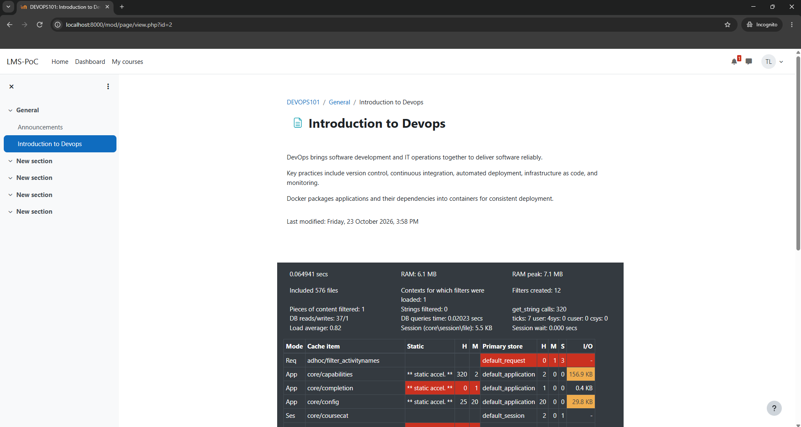
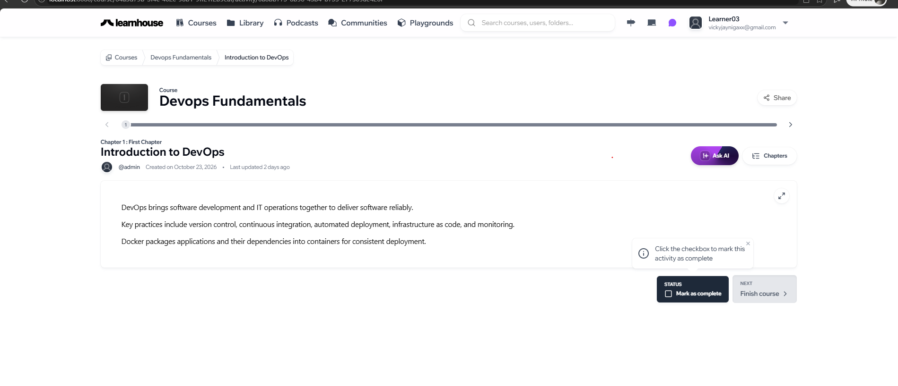
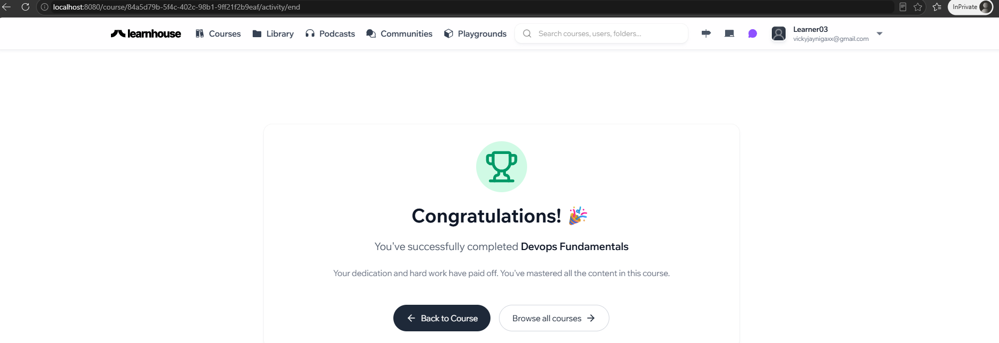

# Self-Hosted LMS Evaluation

Evaluation of self-hosted LMS platforms for internal and client-facing training, covering deployment, resource usage, interoperability and customization.

Moodle and LearnHouse Community were tested locally. Open edX and Canvas were assessed through official documentation.

## Recommendation

**Moodle is recommended for the next-stage pilot**, based on its native SCORM 1.2 support, established plugin ecosystem and lower observed idle memory usage.

LearnHouse is an alternative for straightforward course delivery and a modern interface. Its documented SCORM support requires Enterprise.

See the [recommendation summary](docs/recommendation.md) for trade-offs and production considerations.

## Deliverables

| Document | Contents |
|---|---|
| [Technical Comparison](docs/comparison.md) | Four-platform comparison of deployment, hardware, standards, APIs and authentication |
| [Local Deployment Guide](docs/reproduction.md) | Reproduction instructions for both PoCs and backup/recovery considerations |
| [Recommendation](docs/recommendation.md) | Platform selection, supporting evidence and limitations |
| [Benchmark Records](benchmarks/) | Environment details, raw measurements and per-container peak summaries |

## Verified Results

Both local platforms delivered **DevOps Fundamentals**, containing an **Introduction to DevOps** lesson.

| Check | Moodle | LearnHouse |
|---|---|---|
| Deployment and administrator login | Passed | Passed |
| Course creation and learner access | Passed | Passed |
| Learner course completion | Not tested | Passed |
| Course content retained after restart | Passed | Passed |
| Completion retained after restart | Not tested | Passed |

## Test Environment

Windows 11 · WSL2 Ubuntu 22.04.5 · Intel Core i7-1355U
12 logical CPUs · Approximately 7.6 GiB Docker memory
Docker Engine 29.4.0 · Docker Compose 5.1.1

| Platform | Local URL | Total idle container RAM |
|---|---|---:|
| Moodle | http://localhost:8000 | ~259 MiB |
| LearnHouse Community | http://localhost:8080 | ~604 MiB |

Active resource usage was recorded during 60-second periods of manual learner activity. These single-user observations are not production sizing recommendations or concurrent-load benchmarks. Other applications were running on the host.

## Deployment Findings

- Moodle used the official development Docker stack with PHP 8.3 and PostgreSQL 17.
- LearnHouse used CLI 1.5.1 and application image 1.4.2, with PostgreSQL, Redis, nginx and SSR forwarding.
- LearnHouse required separate publication of the course and lesson.
- Both platforms retained saved course content after container restarts.
- A separate Moodle fresh-database deployment reached installation and HTTP readiness in 290 seconds (4 minutes, 50 seconds), using existing source and configuration. Administrator login was verified afterward.
- Database, content and configuration backups were created for both platforms and stored outside Git.

## Evidence

### Moodle — Learner Course Access

### LearnHouse — Learner Course Access

### LearnHouse — Learner Completion

## Initial Security Assessment

The local Moodle webserver image was scanned with Trivy. The report
recorded 13 critical and 361 high package-level findings; their
applicability requires further review.

See the [security assessment](docs/security-review.md) for findings,
available fix information and limitations, and the
[scan report](benchmarks/security/moodle-image-trivy.txt) for evidence.

No fixes or post-remediation scans have been performed. This assessment
does not establish production readiness.

## Evaluation Limits

- Open edX and Canvas were researched but not deployed locally.
- Standards packages, SSO, API integrations and backup restoration were not tested.
-
- Restart persistence does not establish backup recoverability.
- The local PoCs are not production-ready deployments.
- Full first-time setup duration was not measured. Scoped readiness measurements were 290 seconds for Moodle and 40 seconds for LearnHouse 1.4.2; administrator login was verified afterward for both.
